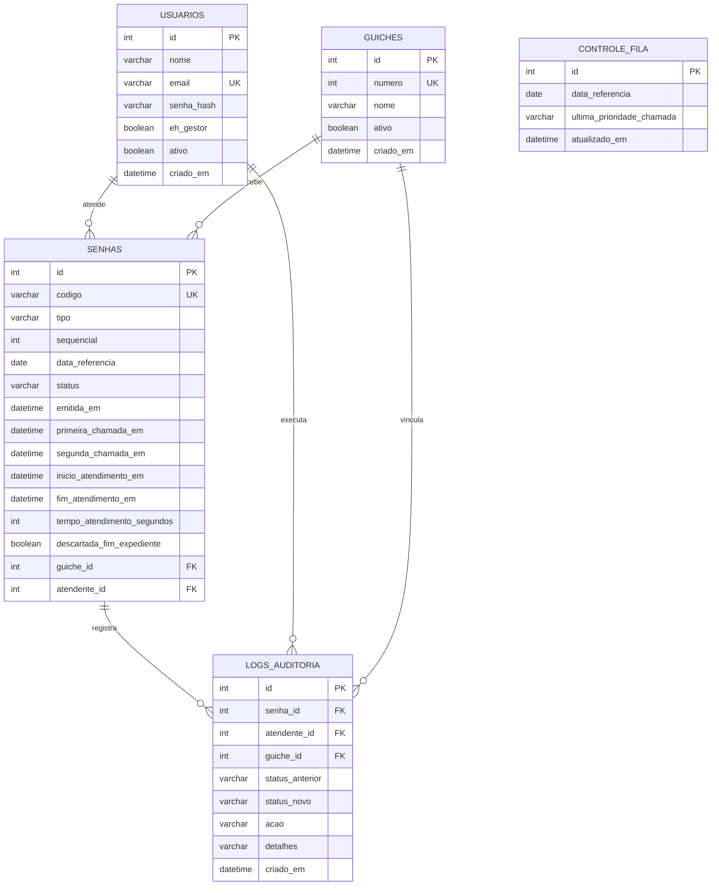

# Modelo Entidade-Relacionamento (MER / DER) — nassauTickets

Modelagem relacional implementada em **MySQL 8.0 (InnoDB)** gerenciada via SQLAlchemy e Flask-Migrate (`backend/migrations/`).

## Diagrama Entidade-Relacionamento (DER)

## Descrição das Entidades

* **`usuarios`:** Armazena os Agentes Atendentes (`AA`) e o único Gestor (`eh_gestor = true`). Utiliza exclusão lógica (`ativo = false`) para preservar integridade referencial de relatórios e auditoria.
* **`guiches`:** Cadastro dos guichês universais (sem restrição por tipo de senha), também com exclusão lógica.
* **`senhas`:** Registro de cada ticket emitido no padrão `YYMMDD-PPSQ`, seus timestamps de ciclo de vida, duração em segundos (`TM`), flag de descarte às 17h e vínculos com atendente e guichê.
* **`controle_fila`:** Tabela de controle transacional utilizada com bloqueio pessimista (`SELECT ... FOR UPDATE`) para garantir o ciclo `[SP] → [SE | SG]` e impedir chamadas duplicadas sob concorrência.
* **`logs_auditoria`:** Trilha cronológica imutável de todas as emissões, chamadas, atendimentos, abandonos automáticos e encerramentos de expediente.