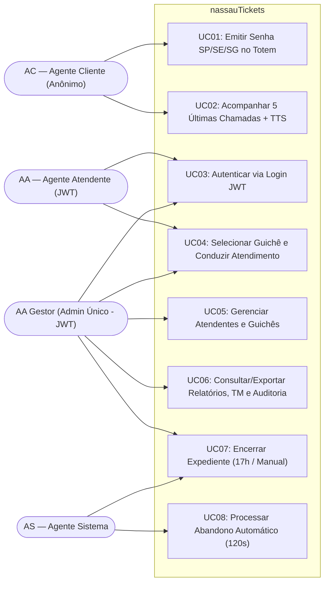
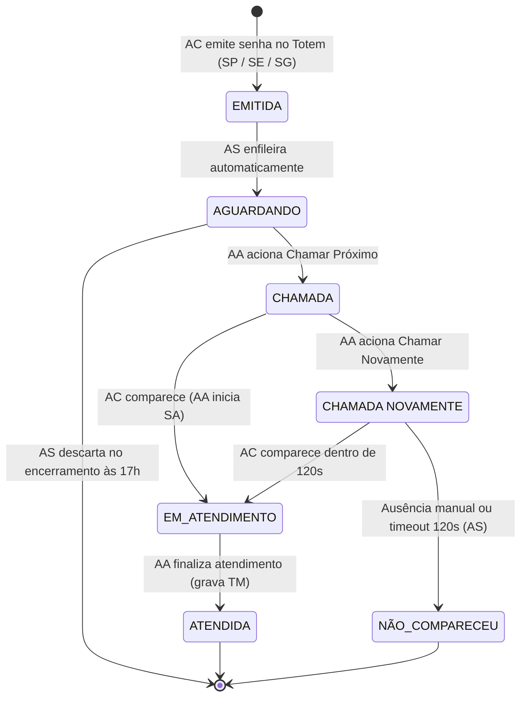
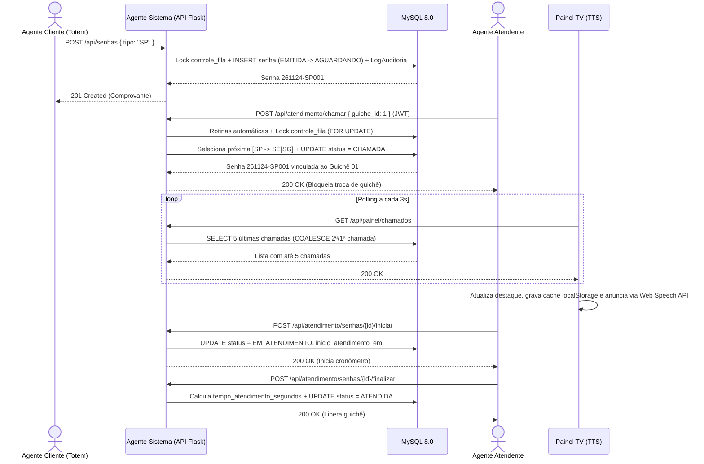
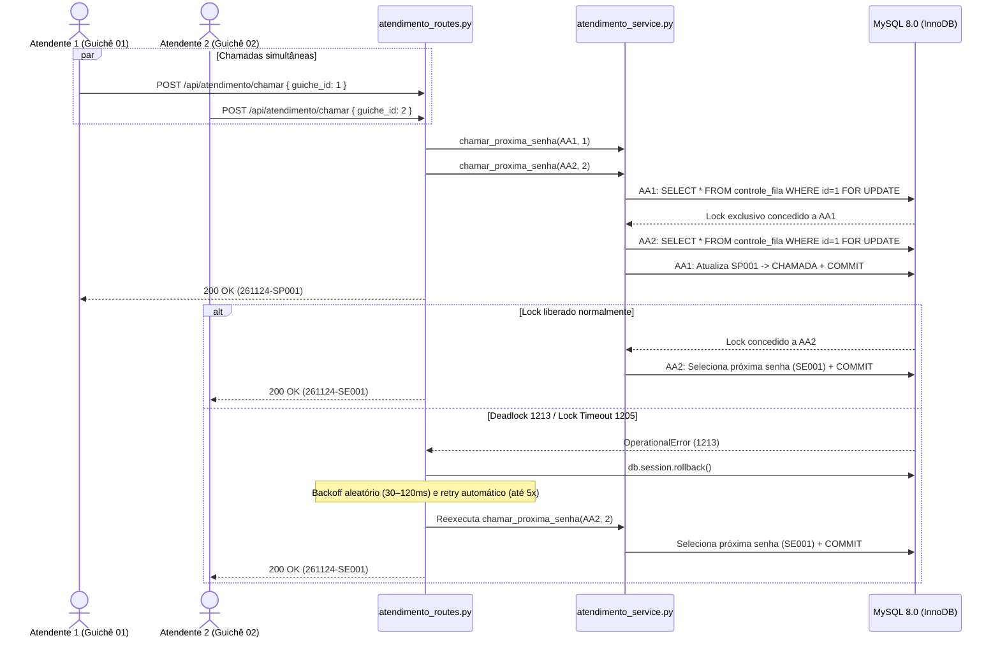

# Diagramas UML — nassauTickets

Diagramas comportamentais e de interação do sistema **nassauTickets** em notação Mermaid.

---

## 1. Diagrama de Casos de Uso

---

## 2. Diagrama de Máquina de Estados (7 Estados)

---

## 3. Diagramas de Sequência

### 3.1 Emissão, Chamada, Painel TV (TTS) e Finalização

### 3.2 Tratamento de Concorrência e Deadlock

